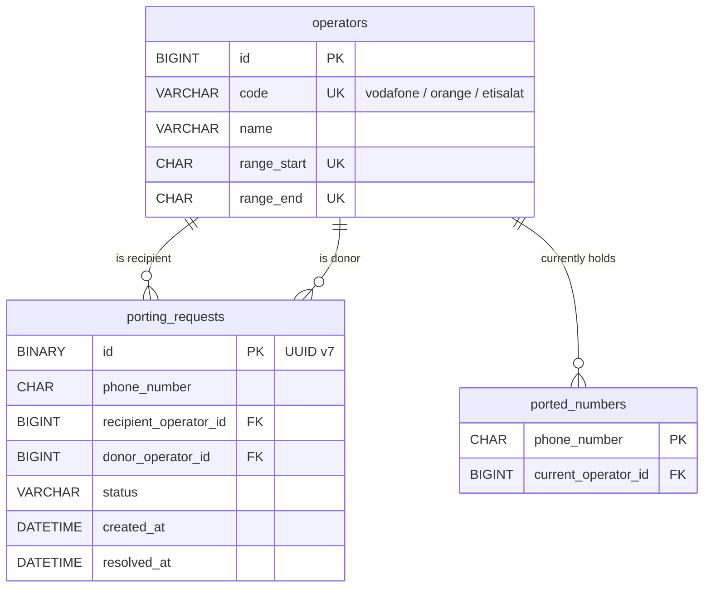

# MNP — Database Schema (MySQL 8)

> Companion to [PLAN.md](PLAN.md). This is the design behind the Flyway migrations in
> `backend/src/main/resources/db/migration/`. The migrations are the source of truth; JPA runs
> with `ddl-auto: validate`.

---

## Conventions

| Rule | Choice |
|------|--------|
| Table names | `snake_case`, plural (`porting_requests`) |
| Column names | `snake_case`; FKs named `<entity>_id` |
| Primary keys | Internal rows: `id BIGINT AUTO_INCREMENT`. Ids exposed to clients (in a URI or a response): `id BINARY(16)` holding a **UUID v7**, generated by the app |
| Phone numbers | `CHAR(11)`, not a number type. The leading `0` matters, and fixed-length strings compare correctly with `BETWEEN` |
| Status | `VARCHAR(20)` + `CHECK`, maps to JPA `@Enumerated(STRING)` (easier to change than MySQL `ENUM`) |
| Timestamps | `DATETIME(3)`, stored in **UTC** |
| Constraint names | `pk_`, `fk_`, `uk_`, `ck_`, `ix_` prefixes |
| Engine / charset | `InnoDB`, `utf8mb4` |

---

## ERD



---

## Tables

### `operators`
The three network operators and the number range each one owns originally. `code` holds the
`organization` header value. Each operator has exactly one range, as in the brief, so the
range lives on this table.

| Column | Type | Notes |
|--------|------|-------|
| `id` | BIGINT PK | |
| `code` | VARCHAR(30) UNIQUE | `vodafone`, `orange`, `etisalat` |
| `name` | VARCHAR(100) | Display name |
| `range_start` | CHAR(11) UNIQUE | inclusive |
| `range_end` | CHAR(11) UNIQUE | inclusive, `CHECK range_start <= range_end` |

### `porting_requests`
One row per request. There is one phone number per request, as the brief requires.

| Column | Type | Notes |
|--------|------|-------|
| `id` | BINARY(16) PK | UUID v7, generated by the app; this is the id used in `/porting-requests/{id}` |
| `phone_number` | CHAR(11) | `CHECK` format `^01[0-9]{9}$` |
| `recipient_operator_id` | BIGINT FK | operator from the `organization` header |
| `donor_operator_id` | BIGINT FK | derived from the number's current holder; `CHECK` ≠ recipient |
| `status` | VARCHAR(20) | `PENDING`, `ACCEPTED`, `REJECTED`, `CANCELED` |
| `created_at` | DATETIME(3) | the timeout counts from this |
| `resolved_at` | DATETIME(3) NULL | set when the request leaves `PENDING`; `CHECK` it's null exactly when status is pending |
| `pending_phone_number` | CHAR(11) **generated** | equals `phone_number` while `PENDING`, else `NULL`. **UNIQUE**, so the database itself blocks a second pending request for the same number |

### `ported_numbers`
The final state of each ported number. Only numbers that have been ported get a row here.
Lookup rule: **current holder = this row if it exists, otherwise the operator that owns the
number's range.** Details of the port (which request, when) come from the latest `ACCEPTED`
row in `porting_requests`, so they aren't copied here.

| Column | Type | Notes |
|--------|------|-------|
| `phone_number` | CHAR(11) PK | natural key, one row per number |
| `current_operator_id` | BIGINT FK | updated each time the number is ported again |

---

## Flyway migrations

The database itself (`mnp`) is created by the MySQL container (`MYSQL_DATABASE`) or by
Testcontainers, so the migrations contain no `CREATE DATABASE` or `USE`. Never edit a migration
once it has run; add a new `V3__...` instead.

```sql
-- V1__create_schema.sql ---------------------------------------------------

CREATE TABLE operators (
    id          BIGINT       NOT NULL AUTO_INCREMENT,
    code        VARCHAR(30)  NOT NULL,
    name        VARCHAR(100) NOT NULL,
    range_start CHAR(11)     NOT NULL,
    range_end   CHAR(11)     NOT NULL,
    CONSTRAINT pk_operators             PRIMARY KEY (id),
    CONSTRAINT uk_operators_code        UNIQUE (code),
    CONSTRAINT uk_operators_range_start UNIQUE (range_start),  -- also serves the range lookup
    CONSTRAINT uk_operators_range_end   UNIQUE (range_end),
    CONSTRAINT ck_operators_range_bounds CHECK (range_start <= range_end)
) ENGINE = InnoDB;

CREATE TABLE porting_requests (
    id                     BINARY(16)  NOT NULL,  -- UUID v7, generated by the app
    phone_number           CHAR(11)    NOT NULL,
    recipient_operator_id  BIGINT      NOT NULL,
    donor_operator_id      BIGINT      NOT NULL,
    status                 VARCHAR(20) NOT NULL DEFAULT 'PENDING',
    created_at             DATETIME(3) NOT NULL DEFAULT CURRENT_TIMESTAMP(3),
    resolved_at            DATETIME(3) NULL,
    pending_phone_number   CHAR(11)
        GENERATED ALWAYS AS (IF(status = 'PENDING', phone_number, NULL)) STORED,

    CONSTRAINT pk_porting_requests PRIMARY KEY (id),
    CONSTRAINT fk_porting_requests_recipient
        FOREIGN KEY (recipient_operator_id) REFERENCES operators (id),
    CONSTRAINT fk_porting_requests_donor
        FOREIGN KEY (donor_operator_id) REFERENCES operators (id),
    CONSTRAINT uk_porting_requests_pending_phone_number UNIQUE (pending_phone_number),
    CONSTRAINT ck_porting_requests_phone_number CHECK (phone_number REGEXP '^01[0-9]{9}$'),
    CONSTRAINT ck_porting_requests_status
        CHECK (status IN ('PENDING', 'ACCEPTED', 'REJECTED', 'CANCELED')),
    CONSTRAINT ck_porting_requests_distinct_operators
        CHECK (recipient_operator_id <> donor_operator_id),
    CONSTRAINT ck_porting_requests_resolved_at
        CHECK ((status = 'PENDING') = (resolved_at IS NULL)),

    INDEX ix_porting_requests_status_created_at (status, created_at),  -- timeout scheduler
    INDEX ix_porting_requests_recipient (recipient_operator_id),       -- visibility
    INDEX ix_porting_requests_donor (donor_operator_id),               -- visibility
    INDEX ix_porting_requests_phone_number_status_resolved_at
        (phone_number, status, resolved_at)                            -- latest accepted port
) ENGINE = InnoDB;

CREATE TABLE ported_numbers (
    phone_number         CHAR(11)    NOT NULL,
    current_operator_id  BIGINT      NOT NULL,
    CONSTRAINT pk_ported_numbers PRIMARY KEY (phone_number),
    CONSTRAINT fk_ported_numbers_operator
        FOREIGN KEY (current_operator_id) REFERENCES operators (id)
) ENGINE = InnoDB;

-- V2__seed_operators.sql --------------------------------------------------
INSERT INTO operators (code, name, range_start, range_end) VALUES
    ('vodafone', 'Vodafone', '01000000000', '01099999999'),
    ('orange',   'Orange',   '01200000000', '01299999999'),
    ('etisalat', 'Etisalat', '01100000000', '01199999999');
```

---

## Key queries the schema supports

```sql
-- Current holder of a number (finds the donor; also used by the number-status endpoint)
-- is_ported: the holder isn't the range owner (a number ported back home counts as not ported)
SELECT COALESCE(pn.current_operator_id, o.id)          AS current_operator_id,
       COALESCE(pn.current_operator_id, o.id) <> o.id  AS is_ported
FROM operators o
LEFT JOIN ported_numbers pn ON pn.phone_number = :phoneNumber
WHERE :phoneNumber BETWEEN o.range_start AND o.range_end;

-- List requests the acting operator may see
SELECT * FROM porting_requests
WHERE recipient_operator_id = :me OR donor_operator_id = :me OR status = 'ACCEPTED'
ORDER BY created_at DESC;

-- Donor accept/reject. Conditional update: 0 rows changed means the request is missing,
-- not ours, or no longer PENDING (e.g. the scheduler canceled it first) → 404/403/409
UPDATE porting_requests
SET status = :newStatus, resolved_at = UTC_TIMESTAMP(3)
WHERE id = :id AND donor_operator_id = :me AND status = 'PENDING';

-- Timeout job (uses ix_porting_requests_status_created_at)
UPDATE porting_requests
SET status = 'CANCELED', resolved_at = UTC_TIMESTAMP(3)
WHERE status = 'PENDING' AND created_at < UTC_TIMESTAMP(3) - INTERVAL 2 MINUTE;

-- On ACCEPT, in the same transaction: record the new holder
INSERT INTO ported_numbers (phone_number, current_operator_id)
VALUES (:phoneNumber, :recipientId) AS new_holder
ON DUPLICATE KEY UPDATE current_operator_id = new_holder.current_operator_id;

-- Port details (when, by which request): the latest accepted request for the number
SELECT id, recipient_operator_id, resolved_at
FROM porting_requests
WHERE phone_number = :phoneNumber AND status = 'ACCEPTED'
ORDER BY resolved_at DESC
LIMIT 1;
```

---

## Design notes

- **Duplicate-pending rule is enforced twice.** The service checks first so it can return a
  clear 409. The unique generated column `pending_phone_number` catches races, because `NULL`s
  don't collide and finished requests never block new ones. MySQL has no partial indexes, so
  this is the usual workaround.
- **Accept/reject vs. timeout race is handled by conditional updates**, not a `version` column.
  Every state change runs `... WHERE status = 'PENDING'`, so whichever update runs first wins
  and the other changes 0 rows. In Spring Data this is a `@Modifying @Query` returning the row
  count. Only write `ported_numbers` when the accept actually changed 1 row, in the same
  transaction.
- **Porting request ids are UUID v7**, because they appear in URIs. Sequential ids could be
  guessed and would show request volume. v7 is time-ordered, so inserts stay at the end of the
  InnoDB primary-key index (random v4 UUIDs fragment it). Hibernate 6 maps `java.util.UUID` to
  `BINARY(16)` on MySQL. Generate v7 in the app, for example with
  `com.fasterxml.uuid:java-uuid-generator` (`Generators.timeBasedEpochGenerator()`). To read ids
  in a MySQL client, use `BIN_TO_UUID(id)`. Operators are exposed by `code`, never by their
  numeric id.
- **Donor is stored, not recalculated.** It's fixed when the request is created, so later
  porting of the same number doesn't change history.
- **Request history is kept.** `porting_requests` is never deleted. `ported_numbers` is only
  the current-state view.
- **`CANCELED` spelling** matches the PDF's state diagram (and so the Java enum).
- **Range overlap** isn't fully enforced by the database. The `UNIQUE` bounds stop two
  operators sharing a start or end number, but catching partial overlaps would need a trigger.
  Seed data is controlled, so this is documented rather than coded.
- **One range per operator.** If an operator ever gets a second range, move the range columns
  back into their own table.
- **Always pass the 2-minute timeout as a parameter** from `application.yaml`. The literal above
  is just for illustration.
- MySQL **8.0.16+** is required for `CHECK` constraints to be enforced; pin `mysql:8.4` in
  Docker Compose.
